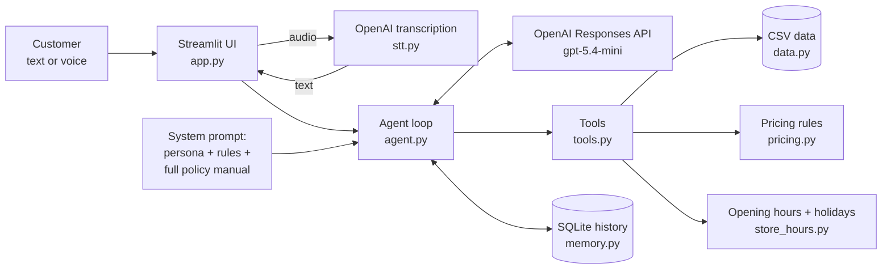

# Design notes

Detailed rationale behind the [README](../README.md): architecture, every technical decision, data assumptions, evaluation and limitations.

---

## Architecture



**Every turn:** the user message and the history go to the model, together with the system prompt and 6 tool definitions. If the model asks for tools, the agent runs them and sends the results back. This repeats until the model writes the answer (at most 6 rounds).

| Tool | When the model uses it |
|---|---|
| `search_products` | "Tem X?", "violões até R$ 1000", price questions. Typo-tolerant search with category, price and stock filters |
| `get_product_details` | Specs of one item. If the item is unavailable, it also returns similar items that are in stock |
| `quote_purchase` | Cart total with every payment option and shipping |
| `find_orders` | Order status, tracking and return/warranty deadlines. **Requires the phone or e-mail used in the purchase** |
| `get_store_status` | "Are you open now?" and before inviting the customer to visit (holidays included) |
| `escalate_to_human` | Complaints, returns, special quotes. Returns a protocol number |

---

## Technical decisions

### 1. Hybrid approach: function calling for data, the full policy text in the prompt
The case asks the agent to know *when to query data* and *when to consult policies*. Those are two different kinds of knowledge, so I handled them differently:

- **Operational data (products, stock, promotions, orders) goes through tools.** This data is structured and changes often, and questions about it need exact filters ("até R$ 1000", "em estoque"). Retrieving CSV rows with embeddings would get those filters wrong. A SQL agent would work, but letting the model write queries against customer data is a bigger risk than offering a small set of safe, tested functions.
- **The policy manual goes entirely into the system prompt, with no RAG.** It is 8 pages (about 2.5k tokens) and every section is relevant to customer service. With a document this small, retrieval only adds a way to fail: a retrieval miss means a wrong policy answer. The manual sits in the static prefix of the prompt, so OpenAI's automatic prompt caching keeps it cheap (see [Evaluation](#evaluation)). If the policy base grew to dozens of documents, I would move it to RAG.

### 2. No agent framework (no LangChain or LangGraph)
The agent loop is about 60 lines (`emporio/agent.py`): call the model, run the tools it asks for, repeat. With only 6 tools and a single agent, a framework would add abstraction and dependencies without adding capability. Owning the loop makes it easy to test with a fake client, to log every tool call, and to explain. If the flows grew (multi-step handoffs, approval steps, several agents), LangGraph would be my first candidate.

### 3. All the math happens in Python, never in the LLM
The policy says incorrect prices "can constitute false advertising" (§7.1), so the tools return values that are already computed and formatted:
- PIX 5% off, which **does not stack** with promotions (§6.2);
- promotions shown as a ready phrase, "de R$ 549,00 por R$ 439,20 (20% OFF)". I added this after an early run where the model swapped the two prices;
- card installments that respect the minimum per installment for each plan (§3.1);
- shipping, and the eligibility for mixing payment methods;
- return and warranty windows (7, 30 and 90 days) computed from the order dates.

The model only decides *what* to say and *how* to say it.

### 4. Model: `gpt-5.4-mini` with low reasoning effort
I used OpenAI because I already had access to it. Among the models available on my account, `gpt-5.4-mini` is fast (about 2–5 s per turn), cheap, and handled the tool use and Portuguese well in the evals. Reasoning effort is set to `low` for chat latency. The model is set through `.env`, and `python -m evals.run_evals --model <other>` compares models on the same scenarios.

### 5. Prompt strategy
`emporio/prompts.py` contains:
- **Persona:** "Lia", with the tone the manual asks for ("como um amigo que entende de música", §7.1).
- **Grounding rules:** never state a price, stock level, order status or deadline without a tool call, plus a map from question type to tool.
- **Privacy rules (LGPD):** order lookups require a matching phone or e-mail. An order number alone reveals nothing, and the agent never confirms that someone is a customer.
- **Scope rules:** the store sells instruments only, so accessories are politely redirected. Off-topic questions get one friendly sentence. Prompt injection and discount requests are refused.
- **Accessibility and sales rules** (sections 6 and 7 below).
- **The full policy manual** at the end.

The rules are explicit and testable, and every rule that changed did so because an eval or a recorded conversation showed a failure. Some examples:
- The agent said "yes, you can return it" before checking the order dates. Now it asks for identification and checks the deadlines first.
- English replies ended with a Portuguese invitation, copied from the Portuguese examples in the prompt. The examples are now in English, with "write it in the customer's language".

### 6. UX for customers who aren't comfortable with technology
The store's customers include older people who mostly use WhatsApp. So:
- **The agent's writing:** short messages (2–5 lines), one question at a time, plain words, no tables, at most 3 products per message, money as "R$ 1.234,56" and dates as "22/11".
- **The interface:** WhatsApp-like bubbles, big fonts, and four large shortcut buttons on the first screen (*Horário e endereço*, *Ver instrumentos*, *Meu pedido*, *Falar com atendente*), because many people don't know what to type. Map, WhatsApp and phone links are always visible.
- **Voice messages:** a microphone sits inside the message box. Audio is transcribed with `gpt-4o-transcribe` and then follows the same path as a typed message. The store's brand names are passed as a vocabulary hint, so the spoken "Takamine GD vinte" comes back as "Takamine GD20".
- **History persistence:** the conversation is saved in SQLite and keyed by the URL (`?s=<id>`). If the customer closes the browser and opens the same link, they continue where they stopped. This is why I implemented history persistence even though the case leaves it optional.

### 7. Sales attitude: invite, never pressure
A store exists to sell, and the instruments are things people want to try before buying. So, after answering about a product that is in stock or about the address or hours, the agent ends with **one explicit invitation to visit**. The invitation uses the real opening time from `get_store_status`, holidays included; the case was built on Finados (02/11), and the agent correctly says the store reopens tomorrow at 9h. The agent also:
- offers delivery instead of a visit to customers from other cities;
- offers in-stock alternatives when an item is unavailable;
- mentions the PIX price and card installments.

It never invents urgency, never insists after a "no", and never sells during a complaint or a return.

### 8. Interface: Streamlit
The role is full-stack, so I wanted a real UI and not only a notebook. Streamlit gave me a chat with audio input and good accessibility in about 150 lines of Python, and it deploys for free on Streamlit Community Cloud. A `MAX_MESSAGES_PER_SESSION` limit protects the API key on a public demo. The CLI (`--debug`) is the development tool.

### 9. Resilience: the customer is never left without an answer
If the LLM is unavailable (outage, timeout, rate limit, invalid key, or an empty answer), the agent still replies, with a **deterministic message built without any API call** (`emporio/fallback.py`). It thanks the customer for the contact and gives the store's WhatsApp, phone, e-mail, address and opening hours. It also says **whether the store is open right now**, computed locally, holidays included: "🔴 Agora a loja está fechada (Finados). Voltamos amanhã às 09:00". A customer who arrives during an outage can still reach the store, so the sale isn't lost.

- **Timeouts.** Each API call has a 25 s timeout and one SDK retry, so nobody waits indefinitely.
- **Circuit breaker.** After a failure, the agent skips the API for 60 s and answers with the fallback instantly, instead of making every customer wait out the same timeout.
- **Valid history.** Only the user message and the fallback are stored, never half-finished tool calls, so the conversation continues normally when the API is back.
- **One source for contact details.** The prompt, the UI and the fallback all read them from `emporio/store_info.py`.

To see it locally, set `OPENAI_API_KEY=invalid` in `.env` and send a message.

---

## Data treatment and assumptions

The data is loaded once into typed dataclasses (`emporio/data.py`). The CSVs are tiny, so I didn't need pandas or a database. The treatment:
- `specs` JSON is parsed. E-mails are lowercased. Phone numbers are compared by their last 8 digits, so "(67) 99812-3456", "67998123456" and "99812-3456" all match.
- Status and stock are combined into **one availability label** (`in_stock`, `out_of_stock`, `coming_soon`, `discontinued`), so the model never has to combine two fields.
- Search ignores accents and tolerates typos ("violao", "guitara gibson", "takamine gd 20") with token-level fuzzy matching (`rapidfuzz`).
- The policy PDF was transcribed once into `data/policies.md`. The content is kept verbatim in Portuguese, with clean tables, and inconsistencies are flagged as `[NOTA]`.

Issues I found in the data, and how I handled each:

| Issue | Decision |
|---|---|
| Phone `(67) 3341-4444` is labeled "Telefone / WhatsApp" in §1.2, but §7 gives the WhatsApp as `(67) 3321-4500` | 3341-4444 is the landline and 3321-4500 is the WhatsApp. The agent shows both |
| The e-mail is spelled with and without an accent (`empóriodamusica`) | Use the unaccented spelling |
| The actual delivery date is not in the data | Use `estimated_delivery` as the delivery date for orders with status `delivered`, when computing return windows |
| No order says whether it was online or in store | Treat orders in the system as online purchases (they have tracking codes), so the 7-day regret right applies |
| Orders 3 and 20: `total_brl` doesn't match the sum of the item prices | Show the recorded total ("total pago"). It may include shipping or a discount that isn't in the data |
| The policy says "300+ instruments", but the CSV has 65, and none in Sopro (wind) or Cordas Orquestrais | The agent says those categories aren't available right now and doesn't invent products |
| Some names contradict their descriptions ("Roland Synth 3" is described as a Yamaha, "Yamaha Bass 3X" as an Ibanez) | Search uses the name, category and description, so a customer may see these items. Flagged as a data quality issue for the store |
| "Até 3x: sem valor mínimo de parcela (exceto abaixo de R$ 50,00)" | Read as a minimum installment of R$ 50 for 1–3x. Combined with R$ 80 for 4–6x and R$ 100 for 7–12x, the tool computes the maximum number of installments |
| Some Black Friday and seasonal promotions are inactive | Only `is_active = 1` applies. The agent says an expired promotion isn't active and shows the current price (§7.3) |
| Shipping to other cities depends on the CEP, weight and size, which aren't available | The agent explains the options (PAC, SEDEX, Jadlog) and that the team gives a quote; it can open a ticket |
| The case says nothing about the conversation language, and the store is Brazilian | The agent replies in pt-BR by default and mirrors the customer's language. One eval scenario covers English |
| Two customer records share `bruno.martins@jmail.com` ("Bruno Carvalho Martins" and "Bruno Martins", same city, different phones). It looks like a duplicate registration, but it can't be proven | A lookup that matches more than one record reveals nothing and asks for the phone or the order number. Taking the first match could show one person's orders to another |
| Relative to today, orders are stuck: #8 was shipped with an ETA of 28/02/2026, and #9–#16 have been pending or confirmed since Feb/Mar 2026 | `find_orders` adds an `attention` note (late delivery, payment pending for more than 5 days, paid but not shipped for more than 7 days). The agent apologizes and offers a ticket instead of reading out an old ETA |
| Kala KA-ABP-CTG is `coming_soon` but appears in orders #3 (delivered) and #14. Ibanez Bass 2X is `discontinued` but has 13 units in stock | Statuses are taken as the source of truth for selling: coming-soon and discontinued items are not offered. Flagged as a data issue; selling the bass as "last units" would be a business decision |

---

## Evaluation

There are two layers:
1. **Unit tests (`pytest`, 43 tests).** They cover the pricing rules, installment minimums, opening hours with holidays (including Easter-based dates), fuzzy search, stock filters, order privacy (the wrong contact or an ambiguous duplicate record reveals nothing), stuck-order alerts, return windows, strict tool schemas, the agent loop with a fake OpenAI client, and the outage fallback (a simulated `APIConnectionError`, the circuit breaker, and recovery).
2. **Behavioral evals (`evals/`, 20 scenarios, real model).** Scripted conversations with deterministic checks:
   - which tools must or must not be called;
   - what the reply must or must not contain (accent-insensitive regex);
   - a maximum length.

   They cover catalog filters, promotions, an expired Black Friday, out-of-stock alternatives, returns after the deadline, privacy, complaints without upselling, accessories, off-topic questions, prompt injection, and an English-speaking customer. Each run saves its full transcripts to `evals/results/`.

**Results with `gpt-5.4-mini`:** 3 full runs (54 scenario runs) on 2026-11-02 → **52/54 passed (96%)**. I read the transcripts of both failures, and **both were false positives of my checks, not agent errors**. In one, the agent correctly said the regret window had expired, but without the literal words "7 dias". In the other, a regex matched across a line break. I fixed those checks afterwards. Latency is **4.6 s median per turn** (8.3 s p90), including the tool calls. On average a turn uses about **8k input tokens** (mostly the cached system prompt and tool schemas) and **about 180 output tokens**.

The evals were the main development tool. Most of the prompt and tool changes in the commit history came from a failing scenario or from reading a transcript.

---

## Known limitations and what I'd do with more time

- **LLM variability.** The same scenario sometimes passes and sometimes fails (for example, it occasionally states the hours without an explicit invitation). The evals measure this, but 20 scenarios is a small set. With more time I would:
  - grow the set with real anonymized conversations;
  - run each scenario several times and track the pass rate;
  - add an LLM judge for tone and conciseness, which regex checks can't measure.
- **Escalation is a stub.** `escalate_to_human` writes to a local JSONL file and returns a protocol number. A real deployment would create a ticket in the store's helpdesk or WhatsApp Business inbox.
- **The data is a static snapshot.** Tools read the CSVs at startup. In production they would call the store's ERP or e-commerce APIs; the tool interface would stay the same.
- **Identity check.** Matching a phone or e-mail is a basic safeguard. In production, I would verify the customer with a one-time code sent to that phone or e-mail, or rely on the verified WhatsApp number.
- **The channel.** The customers live on WhatsApp. The next step would be the WhatsApp Business API, with the same agent behind it. That would also allow voice replies (text-to-speech) for customers who prefer listening.
- **Shipping quotes** for other cities need a carrier API (Correios or Jadlog) by CEP.
- **Observability.** Tool calls and token usage are logged and visible in debug mode. Production would need tracing (for example, OpenTelemetry or Langfuse), conversation analytics, and an alert when "não sei" or escalation rates spike.
- **Holidays.** The agent knows the national holidays, but not Campo Grande's municipal holidays (for example, the city's anniversary on 26/08) or the special hours the store announces on social media.

---

## Project structure

```
app.py                  Streamlit customer UI
emporio/
  data.py               CSV loading and cleaning -> typed records
  pricing.py            PIX, promotions, installments, shipping (pure functions)
  store_hours.py        Opening hours, national holidays, Campo Grande timezone
  store_info.py         Store contacts (single source for prompt, UI and fallback)
  tools.py              The 6 tools + strict JSON schemas
  prompts.py            Persona, rules, and the policy manual
  agent.py              Responses API loop, fallback and circuit breaker
  fallback.py           Deterministic reply when the LLM is down
  memory.py             SQLite conversation history
  stt.py                Voice message transcription
  cli.py                Terminal chat (--debug)
data/                   Original CSVs and PDF + policies.md (clean transcription)
deploy/compose.yml      Single-host deploy behind a Cloudflare Tunnel
tests/                  Unit tests
evals/                  Eval scenarios, runner, conversation recorder
conversations/          Example conversations (deliverable)
```

## Deploy

The live demo runs on my homelab server, behind a Cloudflare Tunnel. The host is an LXC container where BuildKit can't apply AppArmor, so the image is built locally and shipped over SSH:

```bash
docker build -t emporio-agent:latest .
docker save emporio-agent:latest | gzip | ssh <host> 'gunzip | docker load'
ssh <host> 'cd /opt/emporio-agent && docker compose up -d'
```

Public demo safeguards: 40 messages per conversation and 200 per day across all visitors (`MAX_MESSAGES_PER_SESSION`, `MAX_MESSAGES_PER_DAY`).
